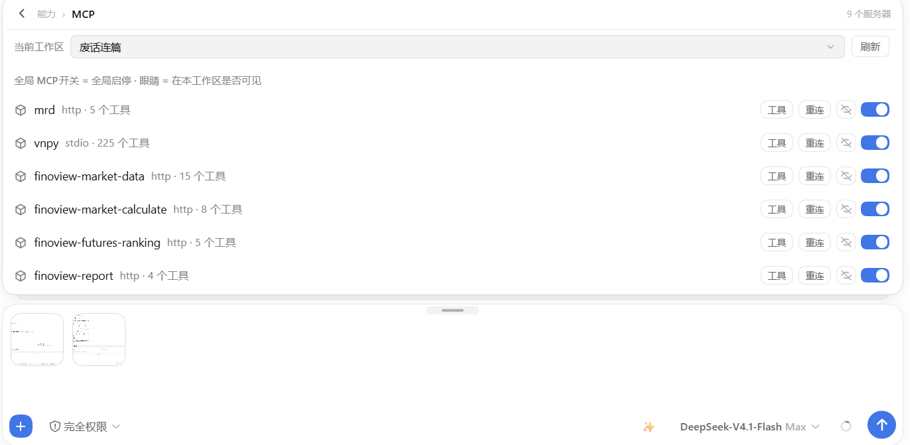
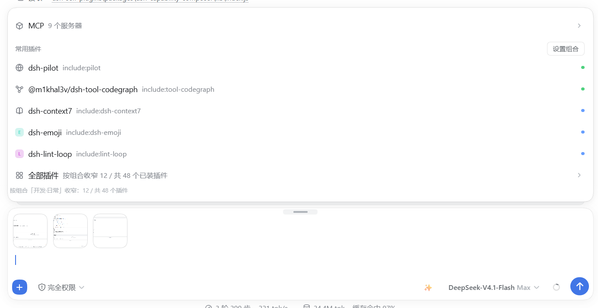

# dsh-composer-launcher

**一个「+」面板统管组合、插件和 MCP。**

> ⚠️ **只支持 DSH 1.5**（`>=0.1.5-rc.2 <0.2.0`）。DSH 出新版本会跟进更新。

> 🟢 **冲突概率极低。** 本插件是**纯 UI 插件,不挂任何服务端接缝** —— 不改请求、不改工具结果、不改系统提示,所以「功能打架」这一层对它不存在;它占的 **4 个客户端槽位全是 `list` / `keyed` 型**,不占任何 `chain` 型。详见下方[兼容性](#兼容性)。

[English](README.md) · **简体中文**

[](LICENSE)
[](#兼容性)
[](#兼容性)
[](#兼容性)

**把输入框左边的「+」按钮，变成一个真正的菜单。**

---

## 目录

- [这是什么](#这是什么)
- [它做什么](#它做什么)
- [截图](#截图)
- [浏览器扩展](#浏览器扩展)
- [设置项](#设置项)
- [HTTP 路由](#http-路由)
- [界面语言](#界面语言)
- [🔗 插件联动](#-插件联动)
- [已知边界（如实说明）](#已知边界如实说明)
- [安装](#安装)
- [兼容性](#兼容性)
- [常见问题](#常见问题)
- [仓库结构](#仓库结构)
- [自检](#自检)
- [License](#license)

---

## 这是什么

默认情况下，输入框左边的 `+` 按钮只会打开一个文件选择器。其它任何你想「指给模型看」的东西 —— 你正在浏览的标签页、一段历史对话、一个技能、一台 MCP 服务器、这台机器上装的某个插件 —— 都只能手打，或者用 `@` 引用。

`dsh-composer-launcher` 把这个按钮换成一个**三组菜单**：

| 分组 | 里面有什么 |
|---|---|
| **添加** | 文件与文件夹、历史对话、计划模式、目标模式 |
| **能力** | 斜杠指令、技能、MCP 服务器 |
| **常用插件** | 每个已装插件一行，外加一行「全部插件」 |

你选中的东西**不会被当成文本粘贴进去**，而是落成输入框上方一条栏上的**原生引用芯片** —— 和宿主自己为 `@` 引用渲染的芯片是同一种 —— 只有在你真正发送时，它才变成消息文本。

另有一个**可选的浏览器扩展**（`DSH Tab Bridge`），它把你真实浏览器里的标签页通过一条本机回环 HTTP 桥推进插件，所以「标签页」那一行列的是你**真的开着**的页面，而不是一个临时调试实例。

---

## 它做什么

### 1. 加号菜单（三组）

一个 360px 高的面板，挂在 `conversation.input.left` 插槽上。

- **添加** —— *文件与文件夹*（宿主自己的选择器，支持多选与拖拽；宿主没有目录选择器时自动退回 `@` 引用）、*历史对话*（走 `remote.sessionReferenceResolver`，只列对话，不含文件）、*计划*、*目标*。
- **能力** —— *指令*（宿主斜杠指令服务提供什么就列什么）、*技能*（用 `ctx.remote.skills.list({ sessionId })` 实时读取）、*MCP*（需要宿主的 `remote.mcpManager`）。
- **常用插件** —— `ctx.remote.pluginInventory.list()` 返回的每个插件一行。这份清单**每次加载都从宿主重新读**，所以装、卸、停用插件会立刻反映出来，不存在需要同步的缓存。三种模式决定显示哪些行：`pinned` / `frequent` / `mixed`（见[设置项](#设置项)）。

每一行都能在设置卡片里单独关掉。

### 2. 引用芯片

选中的东西落在输入框**上方**的一条栏上（`conversation.input.dock`）。一个芯片是 `{ label, kind, icon }` 加一个可选的 `url`，其中 `kind` 只取 `web` / `plugin` / `skill` / `mcp` 之一。点 `×` 删掉它。

有两条特性值得单独说，因为它们在变成特性之前都是 bug：

- **网页芯片一定带着地址。** 一个没有 URL 的页面标题，对读这条消息的人来说毫无用处 —— 所以芯片带着 URL，载荷里也带。
- **会话引用始终是芯片。** 把一个引用写回宿主的纯文本草稿接口，会把它悄悄降级成正文；本插件不这么干，它把引用渲染成芯片，并且绝不让它绕一圈变成文本。

芯片是**按会话隔离**的，两个对话标签页不会共用一条栏。

发送时，每个芯片会被序列化成带短标记的消息文本，这样模型能区分「引用的网页」和「附上的文件」：

| 芯片种类 | 标记 |
|---|---|
| 网页 | `【参考网页】<标题> — <URL>` |
| 插件 | `【使用插件】<名字>` |
| 技能 | `【技能】<名字>` |
| MCP 服务器 | `【MCP】<名字>` |

> 这些标记是**字面量**，两种界面语言下都是中文。它们是**给模型读的**消息文本，不是界面文案 —— 翻译它们等于改变模型看到的内容。

### 3. 设置卡片

注册在 `settings.plugin.item` 插槽上，标题是**启动器**（英文界面下是 *Launcher*）。第一次打开时是折叠的，并且会记住这个选择。十二个字段见[设置项](#设置项)。

### 4. 调试浏览器（退路）

「标签页」那一行还可以通过远程调试端口，从一个由它自己拉起的 Chromium 进程里读标签页 —— 那就是**拉起调试浏览器**做的事；并且只要扩展已暂存，同一次调用就会用 `--load-extension` 把它挂上，然后**去调试端口核实真的挂上了**，所以这条路线**完全不需要人工步骤**（见[浏览器扩展](#浏览器扩展)）。它仍然是退路而不是主入口：它只看得到那一个一次性配置目录的实例，永远看不到你已经开着的那个浏览器。

### 5. 本机回环桥

宿主半边在 `127.0.0.1:43130` 上持有一条很小的 HTTP 桥（可用 `DSH_LAUNCHER_BRIDGE_PORT` 覆盖），好让扩展把标签页推进来。它只绑回环地址，遇到旧实例占着端口时会主动让位，除此之外不做任何别的事。

---

## 截图

**加号菜单 —— 添加 / 能力 / 常用插件 —— 以及由扩展供数的「标签页」行**


**「标签页」行通过桥读取一个真实的 Microsoft Edge 窗口**


**能力组能引用的 MCP 服务器 —— 这一行由宿主的 `remote.mcpManager` 供数**



**「常用插件」组所依据的插件清单，包括它那个「N / M」收窄计数**



---

## 浏览器扩展

没有它插件照样能用 —— 「标签页」行会直接说明扩展没装，并指向那个按钮。装了它，这一行列的就是你**日常那个浏览器**里的标签页。

### 三条装载路线

Chromium **不会**允许任何东西把扩展静默塞进你日常用的浏览器里 —— 这是浏览器的安全规则，插件这边没有绕过的办法。所以目标得换个说法：把**剩下的**每一步都变成「自动」或者「一次点击」。

| 路线 | 会发生什么 | 人工步骤 |
|---|---|---|
| **A —— 本插件自己拉起的浏览器** | 插件另起一个 Chromium 进程，用 `--load-extension` 指向暂存好的那份扩展，然后**通过调试端口核实扩展真的挂上了** | 无 |
| **B —— 你日常那个浏览器** | 「标签页」行提供 *打开扩展管理页* 与 *复制扩展路径*，装一次就是「粘贴 + 加载解压缩的扩展」 | 一次性，约 20 秒 |
| **C —— 受管机器** | Chromium 企业策略（`ExtensionSettings` / `ExtensionInstallForcelist`）指向自托管、已签名的 CRX + HTTPS 更新清单 | 需要管理员权限；**本仓库不提供** |

**路线 A 是核实过的，不是假设。** 拉起之后，插件会向调试端口要原始目标列表，找的是**本扩展自己的 worker**（`chrome-extension://<id>/background.js`），而不是「有扩展就行」—— 每个 Chromium 自己都带好几个。`--load-extension` 被忽略时 Chromium **不会报任何错**，所以「拉起来了」本身什么也证明不了。

如果没找到本扩展的 worker，插件会用干净 profile `~/.dsh-edge-agent-ext` 重试一次，并在返回里用 `healed` / `note` 说明。这不是多余的防御：**被「不带命令行开关」打开过的 profile，之后可能就不再接受这些开关**，本插件默认的 `~/.dsh-edge-agent` 在某些机器上就是这样。两次都失败时 `extensionLoaded` 会如实返回 `false`，「标签页」行退回用调试端口读标签页 —— 插件绝不会声称自己做了实际没做成的那一步。

Firefox 无法这样被拉起：启动器传的是 Chromium 专有开关，所以它是浏览器表里唯一被标成「只能手工」的那个。

路线 B 就是那两个按钮和 `install-extension.ps1` 的用途（见下面「支持哪些浏览器」）—— 两者里都没有任何盘符或用户名。

路线 C 对成建制部署是真实答案，但不在本仓库范围内：它需要管理员权限、你自己签名的 CRX，以及一个提供更新清单的 HTTPS 端点。本仓库一个都不提供，README 也不该假装有。

### 它怎么工作

它**不轮询**，是扩展主动**推送**：

| 触发 | 动作 |
|---|---|
| `tabs.onCreated` / `onUpdated` / `onRemoved` / `onActivated` / `onMoved` / `onAttached` / `onDetached` | 立刻推 |
| 一分钟一次的 `alarms` 心跳 | 推 |
| 浏览器启动、安装、更新 | 推 |

每次推送都是 `POST http://127.0.0.1:43130/composer-launcher/tabs`，body 是 `{ tabs: [...] }`。推送失败会被吞掉，绝不抛出 —— 桥是允许关着的，扩展不能因此在控制台里刷错误。

宿主把最后一次推送保留 **65 秒**（`PUSH_TTL_MS`），**刻意比一分钟心跳长**，这样一次慢心跳不会让这一行闪成空的。**空推送会被忽略而不是照做**（返回 `ignored: 'empty-push-kept-previous'`），因为浏览器偶尔报个空列表，绝不能把清单清掉。

推送的字段是 `{ id, title, url, host, favIconUrl, browser }`。内部页在发送前就被过滤掉了：`chrome:`、`edge:`、`brave:`、`opera:`、`vivaldi:`、`about:`、`devtools:`、`chrome-extension:`、`extension:`、`moz-extension:`。

扩展的弹窗会显示连接状态、允许你改端口，还有一个**保存并立刻推送**按钮，用于不想等下一次心跳的时候。

### 支持哪些浏览器

扩展是 Manifest V3，并且统一走 `globalThis.browser ?? globalThis.chrome`，所以每个 Chromium 浏览器和 Firefox 都能装。

| 浏览器 | 扩展页 | 安装方式 |
|---|---|---|
| Microsoft Edge | `edge://extensions` | 加载解压缩的扩展 |
| Google Chrome | `chrome://extensions` | 加载已解压的扩展程序 |
| Brave | `brave://extensions` | Load unpacked |
| Vivaldi | `vivaldi://extensions` | Load unpacked |
| Opera | `opera://extensions` | Load unpacked |
| Arc | `arc://extensions` | Load unpacked |
| 360 极速浏览器 | `chrome://extensions` | 加载已解压的扩展程序 |
| QQ 浏览器 | `chrome://extensions` | 加载已解压的扩展程序 |
| Firefox | `about:debugging#/runtime/this-firefox` | 临时载入附加组件 |

Chromium 不允许静默旁加载扩展 —— 这是浏览器的安全规则，插件绕不过去（上面的路线 A 和 C 是两个例外，而 C 需要管理员）。所以对日常浏览器，插件能做的是**把路指准**：「标签页」行有 *打开扩展管理页* 按钮（走路由 `POST /composer-launcher/open-extensions-page`，自动挑这台机器上第一个 Chromium）和 *复制扩展路径* 按钮；`install-extension.ps1` 在终端里做同样的事 —— 它枚举**这台机器上真正装了的**浏览器（Windows 上读 `StartMenuInternet` 注册表项，macOS 与 Linux 读各自平台的位置），把它们打出来，然后为你选中的那个打开正确的扩展页。`-Browser <id>` 可以非交互地指定。那个脚本里**没有任何盘符或用户名**。

Firefox 也在支持列表里，但在插件自己的浏览器表里被单独标记：它**不会被提供给调试浏览器启动器**，因为那个启动器传的是 Chromium 专有的参数。

### 端口

默认 `43130`；若环境变量 `DSH_LAUNCHER_BRIDGE_PORT` 能解析成 1024–65535 的整数，则用它的值。这个覆盖开关是为了让一台机器上跑两个 DSH 实例时各留一条自己的桥，而不是互相把端口抢走（本仓库自己的端到端测试正是用它做到这一点的）。扩展那半边的端口可以在弹窗里改：改了一边就要改另一边 —— 不一致的唯一后果是「标签页」行报告扩展离线，并退回调试端口那条路。

`43129` 被识别为旧端口，第一次读到时会自动迁移。

---

## 设置项

命名空间 `composer-launcher`。除了最后一项，其余全是布尔或数字，且全部可选。

| 字段 | 默认 | 含义 |
|---|---|---|
| `showWeb` | `true` | 显示「标签页」行 |
| `webCount` | `3` | 显示几个标签页后收成「还有 N 个标签页」 |
| `port` | `9222` | 本机 **CDP** 端口（调试浏览器那条路，不是桥） |
| `showFiles` | `true` | 显示「文件与文件夹」行 |
| `showPlan` | `true` | 显示「计划」行 |
| `showGoal` | `true` | 显示「目标」行 |
| `showCmd` | `true` | 显示斜杠指令行 |
| `showSkill` | `true` | 显示技能行 |
| `showMcp` | `true` | 显示 MCP 行 |
| `pluginMode` | `"mixed"` | `pinned` \| `frequent` \| `mixed` |
| `pluginCount` | `5` | 显示几个插件行后收成「全部插件」 |
| `pinned` | `[]` | 无论什么模式都固定显示的插件 |

> `pinned` 默认为空是**有意的**，客户端半边也保持同样的空默认。它曾经只在宿主侧的 schema 里列了两个插件名，导致两半不一致 —— 一个从没打开过设置的用户会看到两行自己从没选过的固定插件。

---

## HTTP 路由

全部挂在宿主已有的 web 服务器的 `/composer-launcher` 前缀下。插件**不自开第二个 web 端口**（43130 那条桥是另一条独立的、很小的回环 socket，只给扩展用）。

| 方法 | 路径 | 作用 |
|---|---|---|
| `POST` | `/tabs` | 扩展推送标签页。返回 `{ ok, accepted }`；空推送被拒时返回 `{ accepted: 0, ignored: 'empty-push-kept-previous', kept: N }` |
| `GET` | `/tabs?port=` | 合并后的标签页（扩展优先，CDP 次之）。返回 `{ source, stale, port, sources: { extension, cdp, mixed }, extensionHint, tabs, error }` |
| `GET` | `/stage-extension` | 把随包的扩展拷到一个稳定路径，返回 `{ extensionDir, dir, browsers, note }` —— `browsers` 就是这台机器上真正装了的浏览器列表 |
| `GET` | `/linked-plugins` | 探测伙伴插件。返回 `{ linked: [{ id, label, ok, detail }] }` |
| `POST` | `/open-debug-browser` | 起一个带调试端口、**并且已挂上暂存扩展**的 Chromium 实例；返回里的 `extensionLoaded` 是**去调试端口核实过的**（不是假设），需要换干净 profile 时另有 `healed` / `note` |
| `POST` | `/open-extensions-page` | 打开这台机器上第一个 Chromium 的扩展页，用于那一次手工装载。返回 `{ ok, browser, url }` |
| `GET` | `/bundles` | profile 挂载的插件清单 |
| `GET`\|`HEAD` | `/favicon?u=<编码后>` | 同源 favicon 代理：嗅探字节、缓存 6 小时、响应头带 `default-src 'none'; sandbox` |
| `GET`\|`HEAD` | `/bridge` | 桥的身份：`{ bridge: true, pid, port, holding, startedAt }` |
| `POST` | `/bridge-yield` | 请旧实例让出桥端口 |
| `GET` | `/health` | `{ plugin, extensionTabs, extensionAt }` |

该前缀下其它任何路径返回 404 `{ ok: false, error: 'not found' }`。

写操作是有闸的：非 `GET`/`HEAD` 的请求，如果不是「完全没有 Origin」、不是 `chrome-extension://` 或 `moz-extension://` 来源、也不是同 Host，一律 403 `cross-site request rejected`。favicon 代理是唯一一条接受任意 URL 的路由 —— 正因如此它被沙箱化并做了字节嗅探，而不是被信任。

---

## 界面语言

插件自己的界面文案**跟随宿主语言**，没有独立开关。

- 客户端半边注入 `locale` 服务、读当前语言，并在它变化时**实时重译**，不用刷新。
- 目前随包两份表：**中文**与**英文**，各 194 条，扁平点分命名（`'button.title'`、`'settings.title'`、`'jump.composer.missing'`）。
- 取词顺序是**当前语言 → 英文 → 键名本身**。`t()` 永远不可能返回 `undefined`，也永远不会抛错 —— 缺一条翻译就降级到英文，连键都没有就显示键名，而不是留一行空白。
- 拿不到 locale 服务时，语言依次退回 `document.documentElement.lang` → `navigator.language` → `en`。
- 注册表是**可扩展的**：`registerLanguage(id, table)` 加一份表，插件还会把自己已有的语言通报给宿主 locale 服务，好让它们出现在宿主的语言选择里。
- **扩展**用不了宿主的 locale 服务（它是另一个浏览器进程），所以它走浏览器自己的 `_locales` 机制，带 `en` 与 `zh_CN` 两份，并读 `api.i18n.getUILanguage()`。

---

## 🔗 插件联动

### 与 `dsh-capability-composer` —— 一条真实、双向的联动

> **这是唯一一条会改变你看到什么的联动，所以必须说清楚。**

**启动器做了什么。** 它声明了一个联动插件：

```
{ id: 'capability-composer', label: '能力组合器', path: '/dsh-capability-composer/state' }
```

启动时它探一下那个路径，逐个打印 `connected` 或 `absent`。在客户端半边，它使用组合器自己的接口：

| 用途 | 接口 | 组合器不在时 |
|---|---|---|
| 插件行的收窄范围 | `/dsh-capability-composer/effective?sessionId=…` | 退回**列出全部**插件，并说明为什么 |
| 「设置组合」跳转按钮 | `/dsh-capability-composer/state` | 不跳转，并显示一条可关闭的提示，点名缺失的插件 |

**组合器不在时会发生什么。** 什么都不会坏。「常用插件」组列出所有已装插件，而不是被收窄过的那一撮；两个**设置组合**按钮拒绝跳转，点击后显示 15 秒：

> 未检测到组合器插件 dsh-capability-composer —— 请先安装并启用它，再回来点「设置组合」。

**探测是刻意偏乐观的。** 被拒绝或非 2xx 的响应会被判为「没装」，但**网络层抛错会被当成「可达」**。一个假的「没装」比一个假的「装了」更糟：前者把一个能用的按钮藏起来，后者只是让跳转落到一个暂时没有那个页签的设置页上。

**启动器不做什么。** 它**不计算**收窄数字。「N / M 已装插件」这个计数是在这里渲染的，但两个数字分别来自组合器（`N`）和本插件的插件清单（`M`）。启动器**从不写**组合器的状态。

### 与 MCP 面板 —— 一个入口，不是依赖

「能力」组里的 **MCP** 行由宿主的 `remote.mcpManager` 服务供数（实际场景里由某个 MCP 管理插件提供）。本插件的宿主半边**一行 MCP 代码都没有**；它不读、不配、不重启任何 MCP 服务器。

那个服务不在时，MCP 这一行就是不可用，点了会给出一个直白的理由，而不是静默失败。有哪些服务器、是不是启用的、暴露了哪些工具，完全是 MCP 面板自己的事。

### 与本系列其它插件

`dsh-composer-launcher` 与 `dsh-context-reclaim`、`dsh-aux-degrade` **没有代码级关系**。它们解决的问题不同 —— 那两个管的是「什么进入上下文」和「辅助调用花掉多少预算」，这个管的是「你怎么把东西指给输入框」。单独装任何一个都能用；兄弟插件缺失时，插件清单里那一行只会显示为未安装。

---

## 已知边界（如实说明）

- **启用 / 禁用开关没有接。** 插件行会显示状态并链到设置页，但不会从这里开关一个插件。
- **真标签页只能靠扩展**（或调试浏览器）。没有第三条路 —— 插件没法伸手进一个自己不在其中运行的浏览器。
- **桥端口是 `43130`，除非 `DSH_LAUNCHER_BRIDGE_PORT` 覆盖它。** 扩展那半边可以在弹窗里改。
- **Chromium 不允许本插件把扩展装进你已经开着的那个浏览器里。** 它能自己拉起一个浏览器并把扩展挂上，也能把手工步骤指得很准；要静默装进现有浏览器，需要企业策略与管理员权限，本仓库不提供。
- **Firefox 的 MV3 支持在多数构建里意味着临时载入**，这是浏览器限制，不是插件的。
- **favicon 代理接受任意 URL。** 它被沙箱化、做了字节嗅探与体积限制，但它仍然是唯一一条在把机器暴露出去之前值得先搞明白的路由。

---

## 9. 浏览器扩展提醒：装好就弹一次，指到怎么装

浏览器扩展只属于本插件（加号启动器），所以这个弹窗也只由本插件弹。装好插件后第一次打开界面会弹一次，写清楚：

- **为什么不能自动装**：Chromium 有一条硬规则 —— 任何东西都不允许静默把扩展塞进你日常用的浏览器。扩展文件插件已经放到位，但「加载解压缩的扩展」那一下必须你自己点。
- **三条路**：**A 零人工** —— 点「用带扩展的浏览器打开」，插件另起一个浏览器实例并把扩展挂好；**B 装进日常浏览器**（只需一次）—— 点「打开扩展管理页」→ 开发者模式 → 加载解压缩的扩展 → 选弹窗里印出来的那个目录；**C** 图文步骤见 `tutorial-browser-extension.zh-CN.md`。
- **检测系统**：扩展会主动把标签页推给插件，**收到过推送即判定「已装」**，弹窗立刻不再出现；没收到就是「没装」。这里不猜。
- **随时可看**：浏览器分组里有一个「安装说明」按钮，任何时候点它都能把这份步骤调出来（即使已经装好）。

**本插件不需要给 DSH 打任何补丁** —— 补丁归需要补丁的插件去提醒，扩展归这里，两者互不代言。

## 📚 教程

| 文档 | 讲什么 |
|---|---|
| [浏览器扩展教程（中文）](tutorial-browser-extension.zh-CN.md) | 扩展怎么装：零人工路线 A、日常浏览器路线 B、企业策略路线 C，怎么验证、装不上怎么办，含给你 agent 的提示词 |
| [Browser extension tutorial (English)](tutorial-browser-extension.md) | the same, in English |
| [安装与官方补丁（中文）](tutorial-install-and-official-patches.zh-CN.md) | 四个插件怎么一起装，官方补丁要不要打 补丁本体已开源成补丁库：<https://github.com/xiamubumu/dsh-patch-library>  |
| [Install & official patches (English)](tutorial-install-and-official-patches.md) | the same, in English the patches themselves ship as a library: <https://github.com/xiamubumu/dsh-patch-library>  |

---

## 🔗 同系列

四个插件各自独立、可单装，但配在一起最省。另外三个：

- [`dsh-context-reclaim`](https://github.com/xiamubumu/dsh-context-reclaim) — 上下文回收：工具结果有界化、工具面折叠、前缀稳定化，长会话不越聊越贵
- [`dsh-aux-degrade`](https://github.com/xiamubumu/dsh-aux-degrade) — 辅助调用降级：压缩摘要 / 会话标题不再被高思考档烧光预算
- [`dsh-capability-composer`](https://github.com/xiamubumu/dsh-capability-composer) — 能力组合：把常驻工具面收成几个组合，按需切换

> 全部**只支持 DSH 1.5**，DSH 出新版本会跟进更新。需要打官方补丁的插件装好后会自己弹窗说清楚，一条不漏。

## 安装

### 从 GitHub（推荐，已在全新 `DSH_HOME` 上实测）

```bash
dsh plugin --profile web add github:xiamubumu/dsh-composer-launcher
```

一条命令装好。这就是全部步骤 —— 没有脚本，没有要改的路径。

### 从本地 tarball（离线机器）

去 [Releases](https://github.com/xiamubumu/dsh-composer-launcher/releases) 下载 `dsh-composer-launcher-1.1.0.tgz`，然后：

```bash
dsh plugin --profile web add /path/to/dsh-composer-launcher-1.1.0.tgz
```

### 从插件市场 / npm（暂时还不行）

市场投稿（`awesome-dsh-plugin` 的 PR）还没提交，npm 上也还没发布 ⇒ **现在这两种方式都装不到**。
收录 / 发布之后，市场里搜 **dsh-composer-launcher** 装上即可。

> ⚠️ **已知问题：不要拿 Release 资产的 tarball URL 直接装。**
> `dsh plugin --profile web add https://github.com/.../releases/download/v1.1.0/....tgz` 在 DSH 自带的 pnpm 10.34.5 上会失败：
> `ERR_PNPM_MISSING_TARBALL_INTEGRITY`（[pnpm#14351](https://github.com/pnpm/pnpm/issues/14351)，上游在 pnpm ≥ 12.5.1 才修好）。
> 连装第二个插件时**必然**失败 —— 请用上面的 `github:` 简写或本地 tarball 路径。

### 从本地目录

```bash
node install.mjs
```

或者在 Windows PowerShell 里：

```powershell
pwsh -ExecutionPolicy Bypass -File .\install.ps1
```

`install.ps1` 跑三步，遇到第一个失败就停：

1. **反引号闸门**（`strip-backticks.mjs`）—— 客户端 bundle 在部署前必须一个反引号都没有。它排在第一位是因为它会改文件：改之前检查过的 bundle，不等于最后发出去的那个 bundle。
2. **部署**（`install.mjs`）—— 把发货清单里的文件拷进一个新的 generation，写这个 generation 的 `generation.json` 与 `desired.json`，然后调宿主自己的 `projectGenerations()` 让它生效。它最后会**真的 import 一次宿主半边**并回读 profile 清单，所以一个装不起来的 bundle 会在这里就被抓到，而不是等你下次开机。
3. **复核** —— 回读 profile 的 `dependencies`、`dsh.profile.bundles` 与 generation 投影并断言。

脚本自己找 Node：先看 `PATH`，再看 DSH Desktop 自带的运行时。**你不需要自己装 Node。**

### 然后重启 DSH

插件的宿主半边和它的补丁文件都**只在启动时读一次**。装完重启一次 DSH；客户端半边随后随应用一起加载。

### 扩展（可选）

零人工那条路线**什么都不用做**：打开组合器，在「标签页」行按**拉起调试浏览器**（或 *用带扩展的浏览器打开*）即可 —— 它会起一个 Chromium 并把暂存好的扩展挂上、再核实一遍，全程不碰你日常那个浏览器。

要在你日常用的浏览器里用，只需装一次：

```powershell
pwsh -ExecutionPolicy Bypass -File .\install-extension.ps1
```

它会把扩展放到一个稳定路径，列出它在这台机器上找到的浏览器，并打开对应的扩展页。加 `-Browser edge`（或 `chrome`、`brave`、`vivaldi`、`opera`、`arc`、`360`、`qq`、`firefox`）可以跳过选择。「标签页」行上的 *打开扩展管理页* 与 *复制扩展路径* 两个按钮不用终端就能做掉前半截；完整走法（包括 Chromium 允许什么、不允许什么）都在[浏览器扩展](#浏览器扩展)一章里。

---

## 兼容性

### UI 槽位共存：会不会和别的插件抢位置（2026-10-15 实测）

**本插件不挂任何服务端接缝** —— 它是纯 UI 插件，不改请求、不改工具结果、不改系统提示。所以「和别的插件功能打架」这一层**对它不存在**。

它只占 4 个**客户端槽位**，而槽位类型决定了会不会顶掉别人：

| 槽位 | 类型 | 说明 |
|---|---|---|
| `conversation.input.left` | `list` | 独立位置 |
| `conversation.input.dock` | `list` | 可叠加 |
| `conversation.input.overlay` | `list` | 可叠加 |
| `settings.plugin.item` | `keyed` | 按 key 各占一格 |

**只有 `chain` 型槽位会「只渲染第一个」—— 本插件一个都不占。** 实测本机另有 3 个插件占 `conversation.input.dock`、6 个占 `settings.plugin.item`，均正常共存。

> 补丁库里那条 `ui-renderer-turntail` 治的是 `chain` 型槽位的病；本插件不占 chain 型，**用不到它**。
## 常见问题

<details>
<summary>我需要装那个浏览器扩展吗？</summary>

不需要。插件的菜单、芯片、技能、指令、MCP 和插件行，不用扩展全都能用。扩展只负责把**标签页**那一行填成你真实浏览器里开着的页面。没有它，那一行仍然可以读你自己拉起来的调试实例。

</details>

<details>
<summary>插件能自己把扩展装上吗？</summary>

装进**它自己拉起的**浏览器里，可以 —— 而且那条路线是核实过的，不是假设。装进**你已经开着的**浏览器里，不行：Chromium 禁止静默旁加载，这是安全规则，不是功能缺失。插件能做的是把手工那半截缩到最小 —— 「标签页」行上的 *打开扩展管理页* 与 *复制扩展路径*，或者在终端里跑 `install-extension.ps1`。成建制部署可以用 `ExtensionSettings` / `ExtensionInstallForcelist` 策略加自己的已签名 CRX，但那需要管理员，且本仓库不提供。

</details>

<details>
<summary>我刚装了扩展，「标签页」行却说没装？</summary>

两个常见原因，扩展的弹窗里都看得到：

- 弹窗显示*连不上* —— 端口对不上。两边默认都是 `43130`；你改了一边，就把另一边也改了。
- 弹窗说推过了，但那一行还是旧的 —— 宿主把一次推送保留 65 秒，心跳是一分钟一次，稍等一下，或者点**保存并立刻推送**。

</details>

<details>
<summary>我点「设置组合」没反应。</summary>

那个按钮是往 `dsh-capability-composer` 拥有的设置页里跳。那个插件没装时，启动器**拒绝跳转**并告诉你原因。两个都装了的时候，这个跳转是**真的去点** DSH 自己的设置导航 —— 启动器不会伪造一条设置路由。

</details>

<details>
<summary>「添加」组和「常用插件」组有什么区别？</summary>

**添加**组管的是文件与文件夹（支持多选与拖拽）。**常用插件**组是在消息里**点名一个插件**，不是附加它的文件。

</details>

<details>
<summary>芯片在重新加载后还在吗？</summary>

芯片是按会话的，活在客户端为那个会话保留的内存里。客户端重载时，那条栏会从会话自己的状态重建，而不是丢掉；但芯片不是持久存储 —— 它是一种输入方式，你一发送它就变成了消息文本。

</details>

<details>
<summary>这个插件会往网上发东西吗？</summary>

不会。桥只绑回环（`127.0.0.1`），标签页数据不离开你的机器，favicon 代理也是通过宿主自己的 web 服务器去取，而不是从页面里取。没有任何遥测。

</details>

<details>
<summary>为什么端口是 43130，不做成可配置的？</summary>

因为两半必须对**同一个**数字达成一致，而其中一半（扩展）本来就已经允许用户改了。把两边都做成可配置，只会让「配错」的路径翻倍，换来一个人人都不需要改的设置项。

</details>

---

## 仓库结构

```
.
├── .github/
│   └── workflows/ci.yml         在 Linux / macOS / Windows 上做验证
├── extension/                   浏览器扩展（可选）
│   ├── _locales/en/messages.json
│   ├── _locales/zh_CN/messages.json
│   ├── background.js            采集、推送、心跳
│   ├── manifest.json
│   ├── popup.html
│   └── popup.js
├── lib/
│   ├── client.js                菜单、芯片、设置卡片、多语言
│   └── index.js                 路由、桥、联动探测、favicon 代理
├── screenshots/
├── cordis.patch.yml             插件如何被插入 profile
├── bridge-selfcheck.mjs         跨进程验证桥
├── dsh-paths.mjs                自适应解析 DSH 的主目录与 app 根
├── install-extension.ps1        放置扩展、找已装浏览器
├── install.mjs                  部署（被 install.ps1 调用）
├── install.ps1                  反引号闸门 → 部署 → 复核
├── register.mjs                 开发期用到的注册表辅助
├── strip-backticks.mjs          客户端 bundle 闸门
├── verify.mjs                   布局 / 清单 / 语法 / 密钥检查
├── vault-*.mjs                  本机补丁库的开发辅助脚本
├── package.json
├── README.md                    English
└── README.zh-CN.md              简体中文（本文件）
```

`vault-*.mjs` 与 `register.mjs` 是作者本机的开发工具。除非你手工运行，它们是惰性的，也不属于被部署的那一份。

---

## 自检

在一个干净的检出上可以跑两项检查，都是离线、且除非注明否则只读：

```bash
node verify.mjs
```

布局（清单里 `dsh.bundle.patch` 指向的文件真的存在）、清单字段、对每个源文件做 `node --check`、扫描密钥与残留备份文件、以及硬编码机器路径扫描。它打印 `VERIFY PASSED` 或 `VERIFY FAILED`，失败时退出码非零。

```bash
node bridge-selfcheck.mjs
```

它会**真的起两个 Node 进程**，证明桥在跨进程时的行为 —— 包括第二个实例会主动让位而不是抢端口。**请在 `install.ps1` 之后跑**，因为它需要已部署的插件。

---

## License

MIT —— 见 [LICENSE](LICENSE)。
